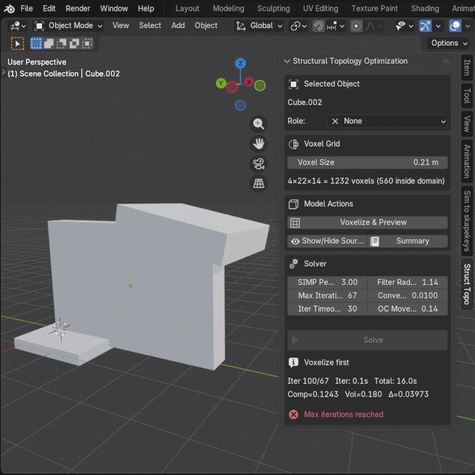
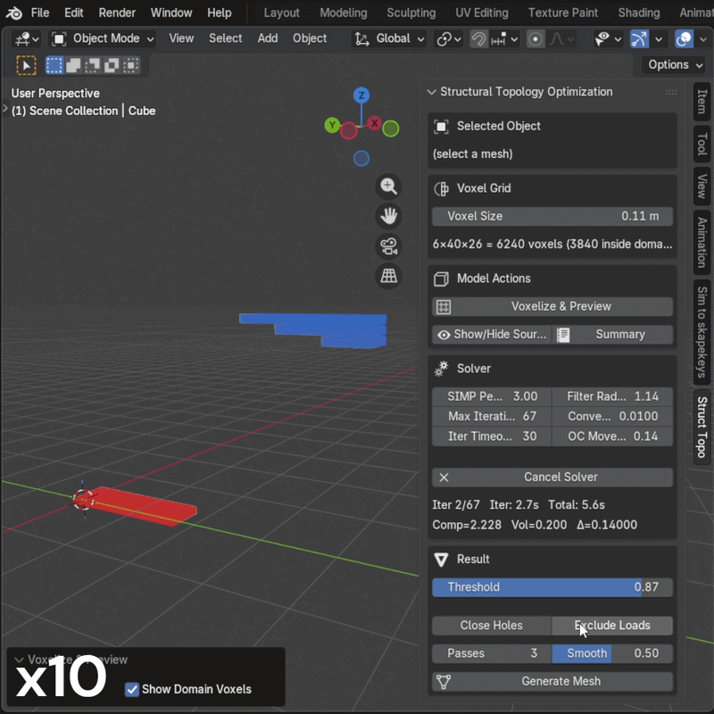
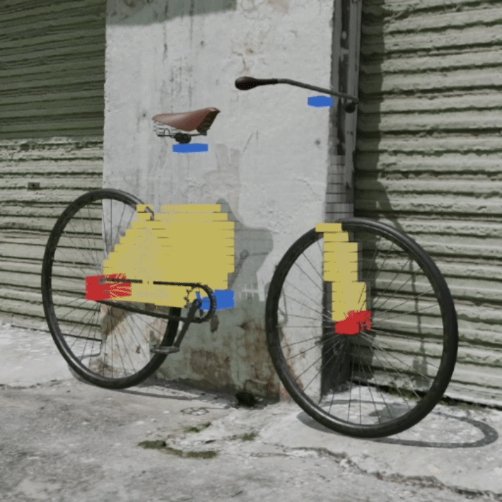

# Structural Topology Optimization for Blender

  

A [Blender add-on](https://extensions.blender.org/add-ons/struct-topo-opt/) for early-stage structural topology optimization, intended as a tool for **geometry discovery** through analyzing applied loads, boundary conditions and material distribution within the given design space.

Inspired by [TopOpt_teach](https://github.com/MCM-QMUL/TopOpt_teach/tree/main), the addon implements a simplified 3D SIMP+OC (Solid Isotropic Material with Penalization and Optimality Criteria) solver and wraps it in Blender's 3D viewport — so you can sketch a design space, tag loads and supports on regular meshes, and quickly visualize where material "wants" to be in a voxelized manner. The aim is to give designers and curious tinkerers a low-friction way to *see* candidate shapes early in a process, without relying on closed or commercially available topology optimization software.

To be clear upfront regarding Blender implementation: this is *structural* topology optimization — finding where material should go inside a design domain to carry given loads — not **mesh topology** editing in the Blender sense (edge flow, retopology, etc.). Blender isn't traditionally a place where this kind of FEA-adjacent solver lives, which is exactly what made it an interesting experiment. Structural mechanics isn't my domain, so treat results as visual sketches rather than verified designs — verify anything load-bearing with proper FEA tools. 

---

## Installation

1. Download the zip for your OS from [Releases](../../releases):
   - `add-on-struct-topo-opt-vX.X.X-windows-x64.zip`
   - `add-on-struct-topo-opt-vX.X.X-linux-x64.zip`
   - `add-on-struct-topo-opt-vX.X.X-macos-arm64.zip`
2. In Blender: **Edit → Preferences → Add-ons → Install from Disk…**, select the zip.
3. The panel appears in the **3D Viewport N-panel** under the **Struct Topo** tab.

---

## Model Setup

Tag regular Blender mesh objects with roles from the **Struct Topo** panel. Each mesh is assigned a role and colored accordingly in the viewport.

| Role | Color | Purpose |
|---|---|---|
| **Boundary Domain** | Grey | The design space — the solver places material inside this volume. *Target Density*: volume fraction to fill (e.g. `0.3` = keep 30% as material). *Young's Modulus* and *Poisson's Ratio* define the material. |
| **Load** | Blue | Voxels here receive the applied force. *Direction*: XYZ vector for the force. *Total Force (kN)*: distributed equally across all load voxels. |
| **Support** | Red | Voxels here are fixed (Dirichlet boundary condition) |
| **Property Region** | Yellow | Voxels constrained to a fixed density. *Target Density*: `1.0` = force solid, `0.0` = force void. |

Once roles are assigned, set the **Voxel Size** and click **Voxelize & Preview**. Only voxels that fit entirely inside the Boundary Domain mesh are used. The viewport switches to Material Preview and shows the voxelized domain as colored cubes (transforms are applied to meshes in this stage). A DOF count and potential warning will be visible if the grid is large enough to make solving slow. (for now)

  

---

## Solver

Run the solver with the **Solve** button. Progress is shown live; iteration count, compliance, volume fraction, and density change per iteration. The solver runs in the background, so Blender viewport stays usable while it works; press **ESC** or **Cancel** to stop.

| Parameter | Default | Description |
|---|---|---|
| **SIMP Penalty** | `3.0` | Penalization exponent. Higher values push densities toward 0 or 1, giving crisper results but potentially slower convergence. |
| **Filter Radius** | `1.5` voxels | Smoothing radius for sensitivity filtering. Prevents checkerboard patterns. Increase if results look noisy. |
| **Max Iterations** | `80` | Hard stop if convergence isn't reached. |
| **Convergence Tol** | `0.01` | Stops when the maximum density change between iterations drops below this value. |
| **Iter Timeout** | `30` s | Cancels the solve if a single iteration exceeds this duration. Reduce grid resolution if this triggers. |
| **OC Move Limit** | `0.2` | Maximum density change allowed per OC step. Lower is more stable; higher converges faster but can oscillate. |

  

---

## Result & Preview

The **Threshold** slider controls which voxels are visible — only voxels with a density above the threshold are shown. At `0.8` you see the densest, most load-bearing material. Lowering it reveals transitional regions.

Click **Generate Mesh** to extract a mesh from the density field. An isosurface is extracted from the density field using the Marching Cubes Lorensen algorithm (via [MarchingNumPy](https://github.com/alistairboyer/MarchingNumPy)), followed by a Smooth Remesh pass and Laplacian smoothing.

| Option | Description |
|---|---|
| **Close Holes** | Fills open boundary edges to produce a watertight mesh. |
| **Include Loads** | Forces load voxels solid in the extracted mesh. |
| **Include Supports** | Forces support voxels solid in the extracted mesh. |
| **Passes** | Number of Laplacian smoothing passes applied after remeshing. |
| **Smooth** | Strength of each smoothing pass (`0` = off, `1` = maximum). |

## Examples

<table align="center">
  <tr>
    <td align="center">
       
      <em>Organic bookshelf generation</em>
    </td>
    <td align="center">
       
      <em>Bike frame generation</em>
    </td>
    <td align="center">
       
      <em> description 3</em>
    </td>
  </tr>
</table>

## Release Notes

### v0.5.0

**Improved**
- New multigrid solver: much faster on large grids (up to ~50×) and uses far less memory.
- Removed SciPy dependancy: downloads shrink to ~50 KB.

**Fixed**
- Install and update errors caused by the bundled SciPy.

### v0.4.6

**Improved**
- Solver up to ~4× to ~8× faster, by setting up the matrix structure once instead of every iteration and leaving out elements outside the domain
- Solver moved to a background thread, Blender UI stays responsive during solve.

**Fixed**
- Property region Target Density between 0 and 1 had no effect, considering now floats.
- Open mesh edges at the domain bounds.
- Low-precision mesh vertices on large grids, fixed with higher precision variables.
- Threshold slider 1.0 showed nothing (max is now 0.99).
- Wrong DOF count in the panel.
- Solver errors reported as "Max iterations reached".

## Acknowledgements

- **[TopOpt_teach](https://github.com/MCM-QMUL/TopOpt_teach/tree/main)** — the 3D SIMP+OC solver this addon is based on.
- **[MarchingNumPy](https://github.com/alistairboyer/MarchingNumPy)** by Alistair Boyer — pure-NumPy Marching Cubes Lorensen implementation used for mesh extraction. MIT License.

